# My Face — a Watchy face made from a 3D scan of my head

<p align="center">
  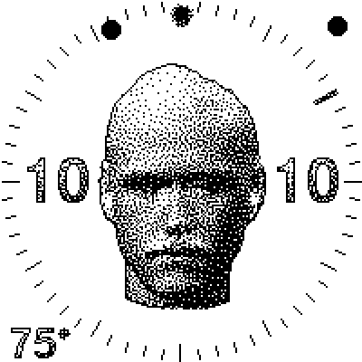
  &nbsp;
  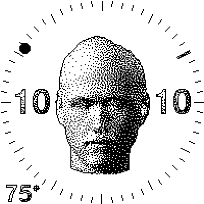
  &nbsp;
  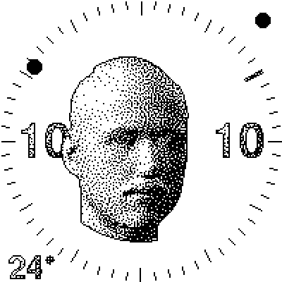
</p>

A custom face for the [Watchy V3](https://watchy.sqfmi.com/) (ESP32-S3, 200×200 e-ink). The watch shows a
stippled 3D scan of my head, **lit like a clock hand**: the key light comes from the hour, a thin rim
light from the minute. The light also follows the real weather, the screen goes dark at night, the mouth
opens at mealtimes, and the head turns to look at you when you raise your wrist.

Nothing about the face is specific to me: the repo has everything you need to **scan your own head and
put it on your wrist** (see [Step 1](#step-1--scan-your-head)). It also includes a **desktop emulator**
that compiles the same face code for the Mac and runs it in the browser, so most changes can be tried
without flashing the watch.

---

## What it does

| | |
|---|---|
| **Time** | Hour on the left, minutes on the right. The key light swings round the head with the hour and the rim light with the minute, so the shading itself tells the time. |
| **Dial = battery** | The ring of minute ticks is the battery gauge: ticks drop out as it drains. Below 15% the whole face dims as a hint to charge. A bolt shows while it's charging. |
| **Weather** | Fetched hourly from OpenWeatherMap. Clear sky gives hard light, cloud softens the shadows, and rain, snow, fog and thunder each get their own effects. The temperature sits in the corner. |
| **Day / night** | Between the real sunset and sunrise the screen inverts to white-on-black. |
| **Mealtimes** | Around 12–1 and 6–7 a second, open-mouth scan dissolves in, dot by dot, over 30 minutes. |
| **Raise to look** | Lift your wrist and the head turns to face you, following the tilt for a few seconds. Walking and typing are ignored. |
| **Buttons** | **Back**: the light makes one lap of the face, then a live second hand runs for 60 s (Back or Menu cancels). **Up**: a fresh dad joke from icanhazdadjoke.com, which closes after 60 s or on Back. **Menu**: settings, plus a *Weather* screen with the raw data and *Start Upload*. |

### The weather, as the face shows it

<table>
<tr>
<td align="center"><br><sub>Clear: hard key light</sub></td>
<td align="center">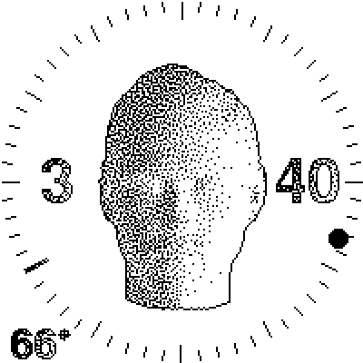<br><sub>Overcast: soft, shadows lifted</sub></td>
<td align="center">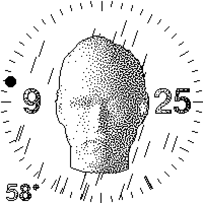<br><sub>Rain, slanted by the wind</sub></td>
<td align="center">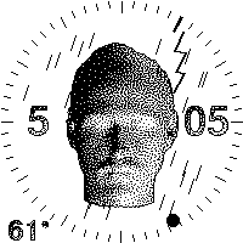<br><sub>Thunderstorm: dark, with lightning</sub></td>
</tr>
<tr>
<td align="center">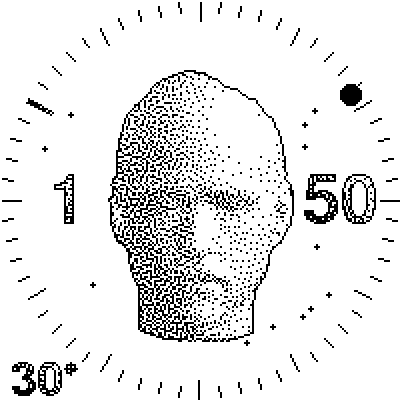<br><sub>Snow</sub></td>
<td align="center">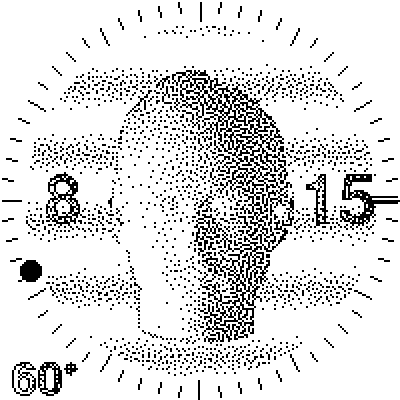<br><sub>Fog: bands of haze</sub></td>
<td align="center">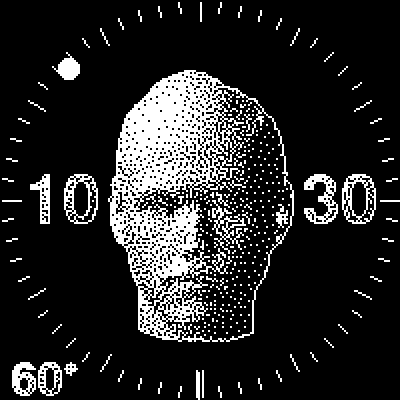<br><sub>After sunset: inverted</sub></td>
<td align="center">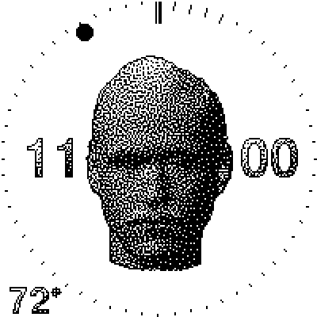<br><sub>Low battery: dimmed, ticks gone</sub></td>
</tr>
</table>

<sub>All screenshots are straight from the emulator: the exact pixels the e-ink panel gets.</sub>

---

## How it's made

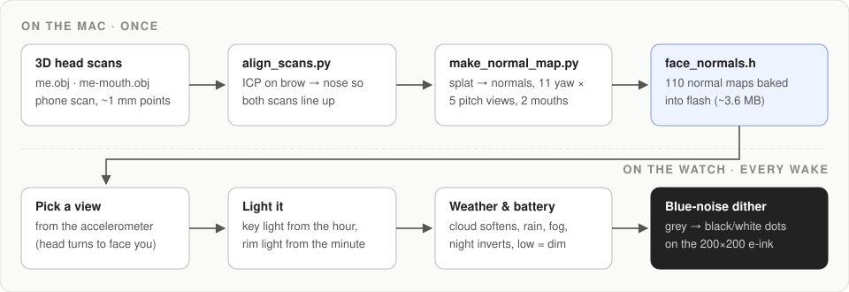

### 1. Scan

Two scans of my head made on an iPhone with the [Heges 3D Scanner](https://hege.sh/) app: one neutral and
one with the mouth open. Heges uses the phone's depth camera to build a dense mesh (~1 mm between points),
which I exported as OBJ. My scans and the normal maps baked from them are kept out of this repo; to build
the face you scan and bake your own head ([Step 1](#step-1--scan-your-head)).

### 2. Align the two scans — `tools/align_scans.py`

The scans come from separate captures, so the head sits in a different place and tilt in each one. ICP
(iterative closest point) finds the rigid move that lays the open-mouth scan's **upper face** onto the
original. It only uses the forehead, eyes and nose, the parts that don't move when the mouth opens.

<p align="center">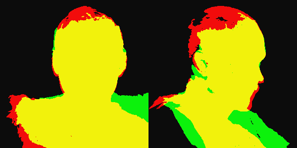</p>
<p align="center"><sub>After ICP: yellow is where both scans overlap; red and green are what only one of them has.</sub></p>

### 3. Bake normal maps — `tools/make_normal_map.py`

No 3D engine runs on the watch. Instead, the head is pre-rendered from **55 angles**: 11 turns (±25°)
× 5 nods (±10°). For each angle the script stores every pixel's **surface normal** (which way the skin
faces) rather than a brightness. It renders by splatting every scan point into a depth buffer with numpy,
which is quick and leaves no gaps at watch resolution. The open-mouth set is baked from the same angles,
borrowing the top of the head from the first scan, since the second only captured the front.

<p align="center">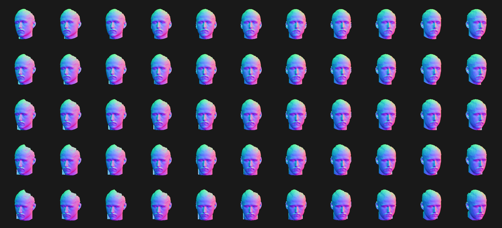</p>
<p align="center"><sub>The 55 views, coloured by normal direction (red = facing right, green = up, blue = toward you).</sub></p>

The result is 110 maps of 117×141 pixels with 2 bytes each, about 3.6 MB. That's too big for the default
app partition, so the face ships its own `partitions.csv` with a single ~7.9 MB app slot.

### 4. Light it on the watch — `MyFaceWatchy.cpp`

Because the normals are stored, the watch can light the head **from any direction at draw time**. A light
is just a vector, and a pixel's brightness is how much its normal faces that vector:

- **Key light**: a broad light that circles the face with the **hour hand**, 35° in front of it.
- **Rim light**: a grazing light from the **minute hand** that catches the edge of the face
  (a sharp `pow(…, 6)` falloff keeps it thin).
- **Ambient**: how bright the side facing away from both lights is.

The weather sets those three levels, mixing clear and overcast light by cloud cover. Fog, storm and
precipitation are layered on top, and low battery scales everything down.

<p align="center"></p>
<p align="center"><sub>Back: the key light does a 12-hour lap of the face, then the live seconds start.</sub></p>

### 5. Dither to dots

E-ink here is pure black or white, so each grey level becomes dots by comparing it against a
**blue-noise** threshold pattern (borrowed from [The Blob](https://github.com/My-Key/TheBlob)). Blue noise
spreads the dots evenly without the grid look of ordered dithering, which gives the stippled,
pen-and-ink feel. The mealtime dissolve uses the same pattern: as the hour approaches, each pixel switches
to the open-mouth map once its noise value drops below the fade amount.

### 6. Sleep, wake, and raise-to-look

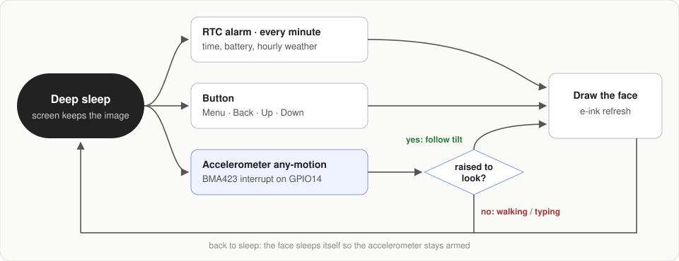

The watch spends nearly all its time in deep sleep with the last frame frozen on the e-ink. The Watchy
library's own sleep only arms the buttons, so the face puts itself to sleep. That lets it also arm the
**BMA423 accelerometer's any-motion interrupt** on GPIO14.

Any-motion fires for every jiggle, though, and the BMA423's built-in wrist-tilt gesture never triggered
on the V3. So on each motion wake the face spends up to 0.6 s **checking for a real raise**:

1. The screen must end up facing you (gravity mostly into the back of the watch).
2. It must have turned at least 25° from where it was resting before the wake.
3. It must hold there for 120 ms.

If any check fails, it was a footstep or a keystroke: the face updates the resting position and goes
straight back to sleep without drawing. Wake-ups are also capped per minute, so a bumpy bus ride can't
drain the battery.

<p align="center"></p>
<p align="center"><sub>Raised to look: the head follows the tilt (the dot in the corner means it's awake).</sub></p>

---

## The emulator

`emulator/` builds a face against stub versions of the Watchy, Arduino and ESP-IDF APIs and runs it as a
normal Mac program. A small Python server drives it and streams every frame to a browser page.

<p align="center">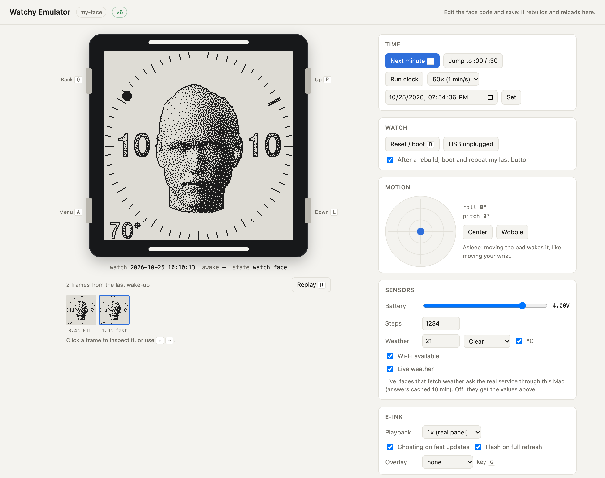</p>

```sh
cd emulator
python3 server.py            # builds faces/my-face (after Step 1), serves http://localhost:8077
```

- **Real time**: frames appear as fast as the e-ink would draw them, and partial/full refreshes are marked.
- **Controls**: the four buttons, a tilt pad that drives the accelerometer, battery and USB, time of
  day, sunrise/sunset, and a weather picker. Or tick **Live weather** to call the real OpenWeatherMap API
  (answers are cached for 10 minutes so the free plan lasts).
- **Live reload**: saving any face or emulator source rebuilds the face and reboots the emulated watch.
- HTTP goes out through `curl`, so the dad jokes are real too.

The emulator is a fast loop, not a substitute for the device. Always do a real `arduino-cli compile`
before uploading, because ESP-IDF name clashes only show up there.

---

## How to make your face

Two steps: bake your head on your computer, then build the face and flash it to the watch.

### Step 1 — scan your head

The repo has the face and the tools, but **no head**: my scans and the `face_normals.h` baked from them
stay on my machine. The face needs a head to draw, so start by making one from your own:

1. **Scan.** Scan your head with [Heges](https://hege.sh/) or any 3D scanner app, ideally including the top
   of your head and down to the neck. Hold still and keep a neutral expression. For the mealtime effect,
   make a second scan with your mouth open; it only needs to cover the front.

2. **Export as OBJ.** The tools expect:
   - a **triangle mesh** (with `f` lines, not a bare point cloud), since normals come from the triangles;
   - **units in metres**, **Y up**, and the **face looking toward +Z**. Heges exports match this as they
     are. With another app, rotate or scale the mesh in Blender or similar first.

   Nothing needs trimming: the tools take the highest point as the crown and cut away the shoulders.

3. **Drop the files in** as `faces/my-face/me.obj` (neutral) and `faces/my-face/me-mouth.obj` (mouth open).
   With only one scan, copy it to both names: the alignment comes out as "no move", and the mealtime
   dissolve fades between two identical heads, so nothing visible happens.

4. **Install the requirements and bake.** You need Python 3.9+ and numpy, nothing else:
   ```sh
   cd faces/my-face/tools
   pip3 install -r requirements.txt
   python3 align_scans.py       # → ../me-mouth-align.npz, ../previews/align.png
   python3 make_normal_map.py   # → ../face_normals.h, ../previews/normal-maps.png
   ```
   The first run of each script parses the OBJ and caches it as a `.npz` next to it, which takes a minute
   for a big scan. Later runs are fast.

5. **Check the previews.** In `previews/align.png`, the two scans should overlap (mostly yellow).
   `previews/normal-maps.png` should show your head straight-on in the middle of the grid. If the head
   comes out too big or small, or too much neck is showing, adjust `HEAD_HEIGHT_PX` and `CHIN_BELOW_TOP`
   at the top of `make_normal_map.py` and bake again.

6. **Try it** in the emulator (`python3 emulator/server.py`) or go straight on to step 2. The emulator
   rebuilds as soon as the new `face_normals.h` appears. The face reads the box size and position from the
   header, so no C++ changes are needed.

### Step 2 — build & upload

**Needs:** [arduino-cli](https://arduino.github.io/arduino-cli/) with the `esp32:esp32` core (3.3.x),
plus the Watchy library (1.4.x) and its dependencies (Adafruit GFX, GxEPD2, Arduino_JSON, Time,
DS3232RTC, Rtc_Pcf8563, WiFiManager).

1. **Weather key.** Get a free key at [openweathermap.org](https://openweathermap.org/api), then:
   ```sh
   cp faces/my-face/secrets.example.h faces/my-face/secrets.h   # paste the key in; it's gitignored
   ```
   Set your city, units and time zone in `faces/my-face/settings.h`.

2. **Compile** (needs the `face_normals.h` from step 1):
   ```sh
   cd faces
   arduino-cli compile --fqbn "esp32:esp32:esp32s3:FlashSize=8M,PartitionScheme=custom,CDCOnBoot=cdc" my-face
   ```

3. **Upload.** The watch's USB port only exists while it's awake. On the watch, open
   **Menu → Start Upload**, which keeps it awake for 60 s, then run:
   ```sh
   arduino-cli upload --fqbn "esp32:esp32:esp32s3:FlashSize=8M,PartitionScheme=custom,CDCOnBoot=cdc" \
     -p /dev/cu.usbmodem* my-face
   ```
   While it waits, *Start Upload* also prints accelerometer and battery diagnostics over USB serial,
   which is handy for tuning the raise-to-look thresholds.

On first boot the face joins Wi-Fi (set up from the menu), syncs the time over NTP and fetches the weather.

---

## Layout

```
faces/my-face/
  my-face.ino          entry point
  MyFaceWatchy.cpp/.h  the face: lighting, weather, dial, motion, jokes, menu
  face_normals.h       generated by tools/ from your scan (not in the repo)
  BlueNoise200.h       200×200 blue-noise dither pattern
  settings.h           city, units, time zone, update interval
  secrets.example.h    copy to secrets.h with your OpenWeatherMap key
  partitions.csv       one big app slot for the normal maps
  tools/               scan alignment and normal-map baking (Python + numpy, see requirements.txt)
  previews/            design-iteration images
emulator/
  server.py            build, run, and serve the browser UI
  build.sh             compile a face for the Mac with clang++
  core/                emulated watch: display, RTC, accelerometer, sleep, HTTP
  stubs/               Arduino / Watchy / ESP-IDF headers the face compiles against
  web/index.html       the emulator page
docs/images/           README images (rendered by the emulator)
```

## Credits

- [Heges 3D Scanner](https://hege.sh/) by Marek Šimoník: the iPhone app used to scan the head.
- [Watchy](https://github.com/sqfmi/Watchy) by SQFMI: hardware and base library.
- Blue-noise pattern from [The Blob](https://github.com/My-Key/TheBlob) by My-Key (MIT).
- Weather from [OpenWeatherMap](https://openweathermap.org/), jokes from [icanhazdadjoke](https://icanhazdadjoke.com/).
